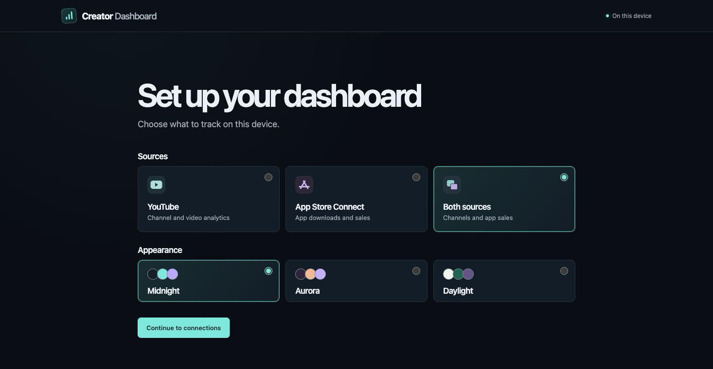

# Argus Pip

A desktop app for creators who check YouTube Studio and App Store Connect throughout the day. Open it to see how your latest video is doing, compare app sales with the previous period, or save a PDF report. Your connections and reports stay on your computer.

## Download and install

**[Download Argus Pip for Mac or Windows](https://github.com/pond1982/creator-dashboard-desktop/releases/latest)**. Open **Assets** on the release page and choose the file for your computer. The installer includes the app, its runtime and its PDF exporter.

| Your computer | Choose | Install |
| --- | --- | --- |
| Mac with an Apple M-series chip | `mac-arm64.dmg` | Open the disk image, drag **Argus Pip** to **Applications**, then open it from Applications. |
| Mac with an Intel processor | `mac-x64.dmg` | Follow the same steps using the Intel disk image. |
| Windows 10 or 11, 64-bit Intel or AMD | `win-x64.exe` | Double-click the installer, then open **Argus Pip** from the Start menu. |

On a Mac, choose **Apple menu → About This Mac**. **Chip** followed by Apple M1, M2 or later means Apple silicon. **Processor** followed by Intel means Intel. The Mac app requires macOS 13 Ventura or later. [Electron platform support](https://www.electronjs.org/docs/latest/breaking-changes#removed-macos-12-support)

**First launch.** These community builds have no verified publisher certificate or Apple notarization. If macOS blocks an installer you trust from this release, try opening the installed app once, then use **System Settings → Privacy & Security → Open Anyway** if offered. Windows may show an unknown-publisher warning. For a SmartScreen reputation warning, review **More info** to see the file and any available launch option. Devices managed by a workplace may require administrator approval. Each release includes SHA-256 checksums. [Apple’s first-launch instructions](https://support.apple.com/en-us/102445) · [Microsoft’s app protection guide](https://support.microsoft.com/en-gb/windows/security/windows-security/app-browser-control-in-the-windows-security-app)

## Connect your first source

1. Open the app. Choose **YouTube**, **App Store Connect**, or **Both sources**, then pick **Midnight**, **Aurora**, or **Daylight**.
2. Select **Continue to connections**. For YouTube, enter one Google API key and add as many channel rows as you need. For Apple sales, select your team’s reporting key and enter its IDs and vendor number. The guide walks through each provider screen. [Step-by-step credential guide](docs/credentials.md)
3. Open a channel or the App Store tab. To add private Studio metrics, choose **Connect Studio analytics** on the channel you own and authorize it in your usual browser. Repeat for each channel whose private reports you want.



## What you can track

| Source | Available reports |
| --- | --- |
| YouTube | Subscriber and lifetime view counts, latest release and up to 25 recent public videos per channel. Compare views, likes and comments. With Studio connected, see watch time, average view duration, subscribers gained and lost, traffic sources and viewer countries. |
| App Store Connect | Paid and free downloads, paid in-app purchases and estimated proceeds by app. Compare 1, 7, 30 or 90 reporting days with the previous period. Choose a currency and ranking metric. |
| PDF | Select **Export PDF** on a channel or sales page. Save the selected channel or the selected sales period and currency to your computer. |

**Settings** controls the theme, sources and visible channel tabs. Disabling a source pauses its scheduled updates and retains the connection. Hiding a channel only hides its tab. To change the channel list itself, open **Connections → YouTube**. Leave the key field blank to reuse the saved key.

**Background updates.** Closing the window keeps the app in the Mac menu bar or Windows notification area. Use its app icon to reopen it, enable **Launch at login**, or select **Quit Argus Pip**. While the app is running and online, public YouTube counts refresh every 30 minutes and private Studio reports refresh every six hours. Apple generally releases the previous day’s sales by 8 a.m. Pacific. A first 90-day comparison may fetch up to 180 daily reports. The app caches them and identifies missing dates. [Apple reporting schedule](https://developer.apple.com/help/app-store-connect/reference/reporting/sales-and-trends-reports-availability/)

## Privacy and local storage

The desktop window talks to a local service accessible with a per-launch session key. Your computer requests reports directly from Google and Apple. Credentials are encrypted using macOS Keychain-backed storage or Windows user-account encryption (DPAPI). Report snapshots and preferences are ordinary files in your user profile. [Data locations, revocation and reset](docs/credentials.md#pause-updates-revoke-access-or-remove-local-data)

### Upgrading from Creator Dashboard 1.0

If **Launch at login** is enabled, turn it off in the old app’s menu. Quit **Creator Dashboard** from its menu bar or notification area icon, install **Argus Pip**, then open it from Applications or Start. Argus Pip uses the same desktop data folder. To launch the renamed app automatically, turn on **Launch at login** in Argus Pip.

### Moving from the original Mac browser dashboard

If the app finds an earlier Mac setup on its first launch, it offers an import. Double-click **Stop Dashboard.command** in the project folder, or run `npm stop` there if you have an earlier copy. Then open the desktop app and select **Import setup**. This copies saved connections, reports and preferences into the desktop app’s own folder. Keep the original service stopped while using the imported connections. Choose **Start fresh** for a separate setup.

## Run from source

Developers can use Node.js 24 LTS and npm on Mac or Windows. From the repository folder:

```sh
npm ci
npm test
npm run desktop
```

Build a local installer with `npm run dist:mac` on macOS or `npm run dist:win` on Windows. The release workflow tests the installers on both Mac architectures and Windows x64.

The original Mac browser service is still available from source with Node.js 22+, Apple Command Line Tools and Google Chrome for PDF export. Double-click **Start Dashboard.command** or run `npm start` and open `http://127.0.0.1:47831/`. Run `npm stop` from the project folder to stop its login service.

Released under the [MIT License](LICENSE).

## Pondd’s collection

The app footer includes reciprocal links to [Pondd’s portfolio](https://pond1982.github.io/Pondd-Page/), [Bangkok Sky Zero](https://pond1982.github.io/bangkok-sky-zero/) and the rest of the collection, plus the original dancing Pondd Easter egg. Its model, textures and Three.js runtime are bundled locally; no external scripts or security-policy changes are required. This source addition is not included in previously published installers.
