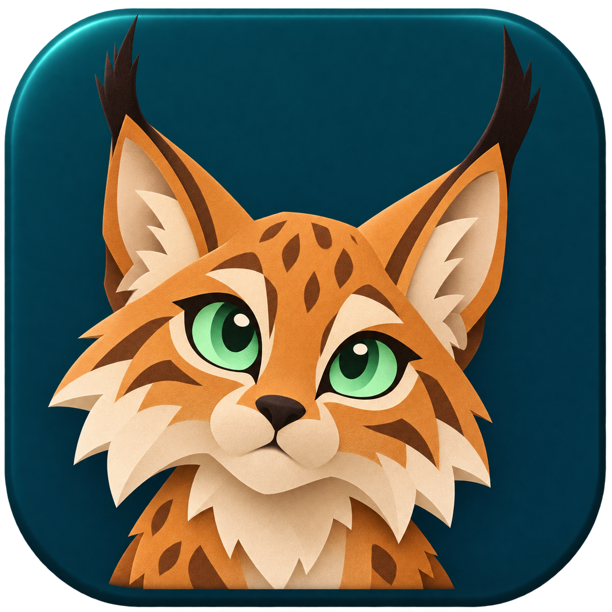
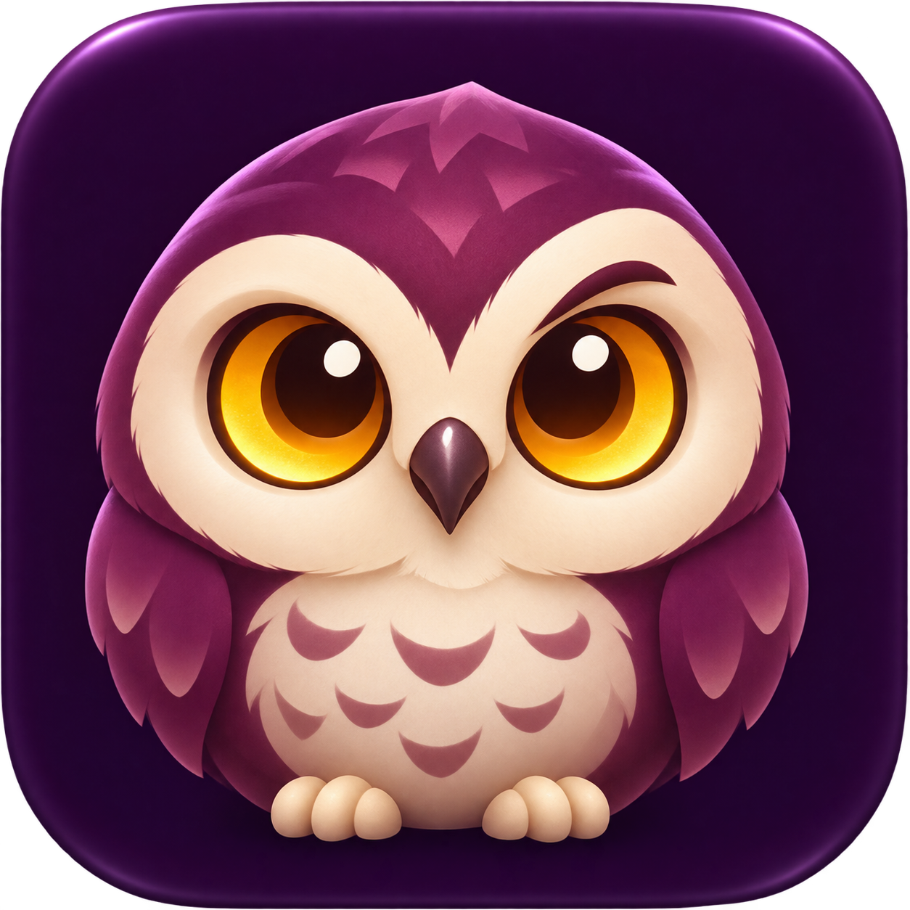
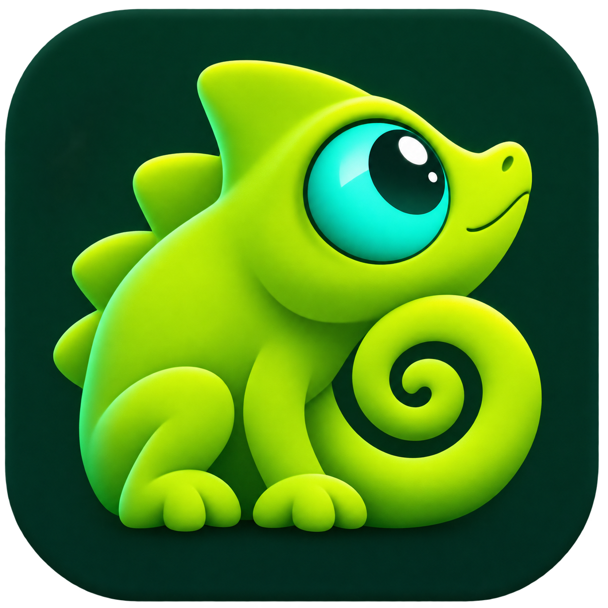
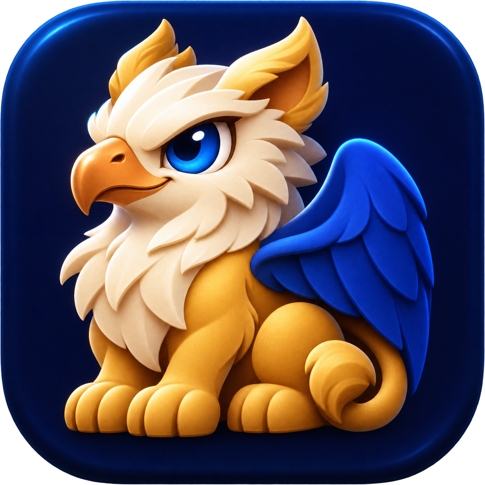

# Argus Pip artwork

The purple three-eyed guardian is the app’s mascot. Download the artwork pack for the original images, native icons and product previews, or open a file below. [Download artwork ZIP](https://github.com/pond1982/creator-dashboard-desktop/releases/latest/download/Argus-Pip-Artwork.zip)

| Use | Asset |
| --- | --- |
| Original mascot | [Full-resolution PNG](brand/argus-pip.png) |
| Desktop app | [1024px PNG](../build/icon.png) · [macOS icon](../build/icon.icns) · [Windows icon](../build/icon.ico) |
| Window header, favicon and widget resource | [128px PNG](../public/argus-pip.png) |
| macOS menu bar | [Standard template](../public/argus-pip-tray.png) · [Retina template](../public/argus-pip-tray@2x.png) |
| Product previews | [Desktop onboarding](../docs/images/onboarding.png) · [Mac widgets](../docs/images/widgets.png) |

## Mascot concepts

| [Tallytuft](concepts/tallytuft.png) | [Hootkeeper](concepts/hootkeeper.png) | [Peekscale](concepts/peekscale.png) | [Gryphwick](concepts/gryphwick.png) |
| --- | --- | --- | --- |
|  |  |  |  |
